<div align="center">

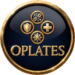

# OPlates

### One circle. Every answer.

**The nameplate overlay that tells you who you are fighting — before you finish the thought.**

Built for **World of Warcraft: Wrath of the Lich King 3.3.5a**, with love for the Warmane community.

[](https://github.com/FreakySphere/OPlates/releases/latest)
[](#-compatibility)
[](LICENSE)
[](https://github.com/FreakySphere/OPlates/issues)

[✨ The idea](#-the-idea) · [📸 See it](#-see-it) · [⚡ Install](#-install-in-30-seconds) · [🧩 Compatibility](#-compatibility) · [🗺️ Roadmap](#-roadmap) · [💛 Support](#-support-oplates)

</div>

---

## ✨ The idea

Nameplate addons are very good at showing you **bars**. Health, resources, cast bars — all of it, beautifully.

None of them tell you **who** is behind the bar.

OPlates adds exactly one thing: a single **circular icon above every friendly and enemy player**, carrying the one piece of information you actually need in that half-second — their class, their spec, their role, the crowd control that just landed on them, or the buff you have been waiting for. The border is their class color. Target them and it pulses yellow. That is the whole addon, and that is why it works.

> **It does not replace your nameplates.** TidyPlates, ThreatPlates, Kui Nameplates, NotPlater, ElvUI — keep every bar, every font, every pixel of your setup. OPlates draws on top of it.

---

## 📸 See it

In-game, on a 3.3.5a client. Nothing staged.

### 🟡 The plates

One circle above every friendly and enemy player. Class, spec or role — your choice, per side — inside a ring that is always their class colour. Nothing else is drawn on the plate.

<p align="center">
  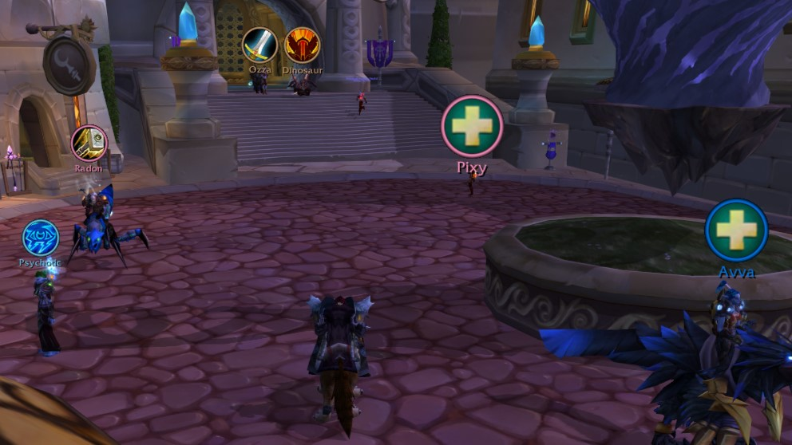
</p>
<p align="center"><sub><b>Friendly plates · Dalaran</b> — warrior, shaman and two healers, each with their own circle</sub></p>

### ⚔️ In combat

The same rule at full speed in Warsong Gulch. The flag carrier is marked, the healers are crosses, everyone else is their class. You read the fight in one glance instead of hovering names.

<p align="center">
  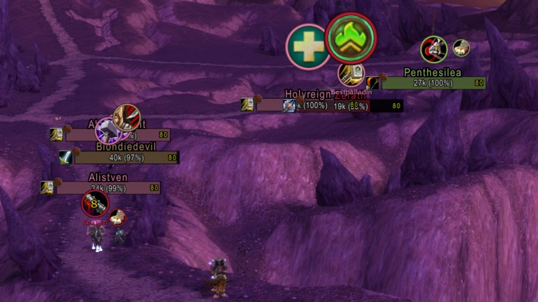
</p>
<p align="center"><sub><b>Enemy plates · Warsong Gulch</b> — flag carrier, healer and class icons at the same time</sub></p>

### 🎯 Target highlight

Target a player and their ring turns yellow and pulses. Switch away and it snaps straight back to their class colour — no fade, no delay.

<p align="center">
  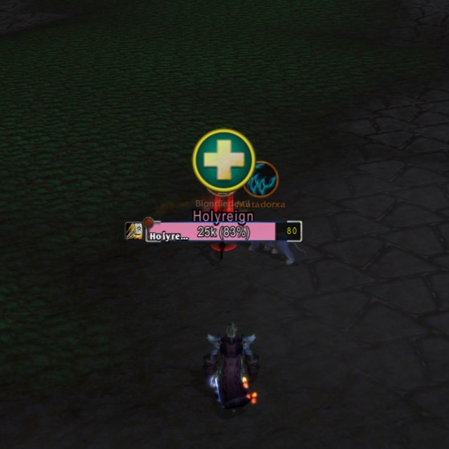
</p>
<p align="center"><sub><b>Targeted enemy healer</b> — the yellow ring follows your target</sub></p>

### 🌀 Crowd control, the instant it lands

A stun lands and the class icon is gone, replaced by the CC icon with its remaining duration ticking down. The moment the effect ends, the class icon is back. Smart diminishing returns keep the timer honest, and priority decides what you see when effects overlap.

<p align="center">
  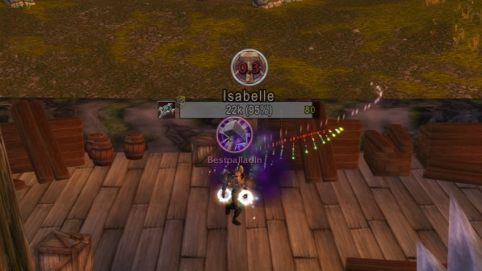
</p>
<p align="center"><sub><b>Stun on an enemy</b> — CC icon with a live countdown, back to class the instant it ends</sub></p>

### 🚨 Healer CC alerts

A second layer, for your own group. When a healer gets controlled, an alert appears wherever you put it, with the countdown and an optional one-click dispel or breaker.

<p align="center">
  
</p>
<p align="center"><sub><b>Healer CC alert</b> — countdown, plus a breaker your character actually knows</sub></p>

### 🎛️ Filters for every class and every spec

Configured separately for friends and enemies. Click an icon to hide it — the change applies instantly, and hiding an icon never hides the player.

<table>
<tr>
<td width="50%" align="center">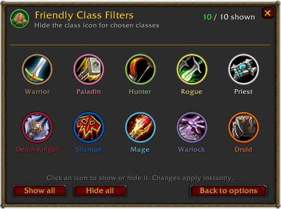<br><sub><b>Friendly Class Filters</b></sub></td>
<td width="50%" align="center">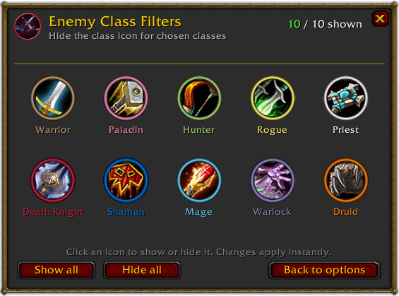<br><sub><b>Enemy Class Filters</b></sub></td>
</tr>
<tr>
<td width="50%" align="center">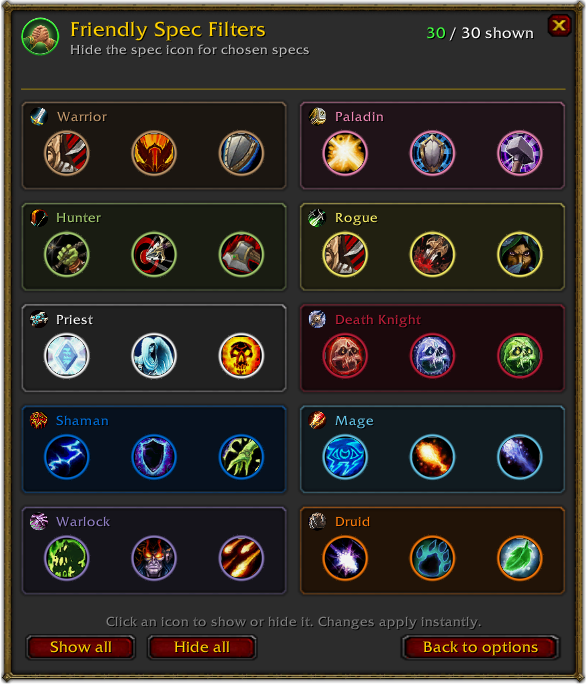<br><sub><b>Friendly Spec Filters</b> — all 30 specs</sub></td>
<td width="50%" align="center">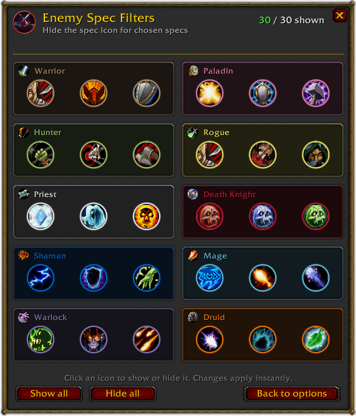<br><sub><b>Enemy Spec Filters</b> — all 30 specs</sub></td>
</tr>
</table>

### 🖼️ More from the battlefield

<table>
<tr>
<td width="33%" align="center">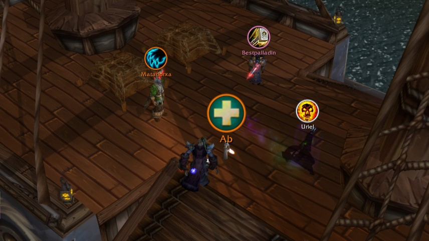<br><sub>Friendly plates, ship deck</sub></td>
<td width="33%" align="center">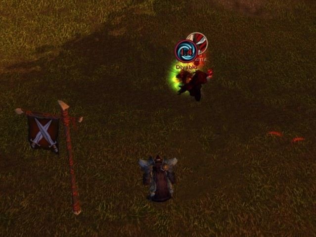<br><sub>Duels</sub></td>
<td width="33%" align="center">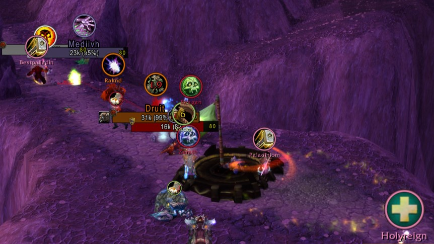<br><sub>Battleground fight</sub></td>
</tr>
<tr>
<td align="center">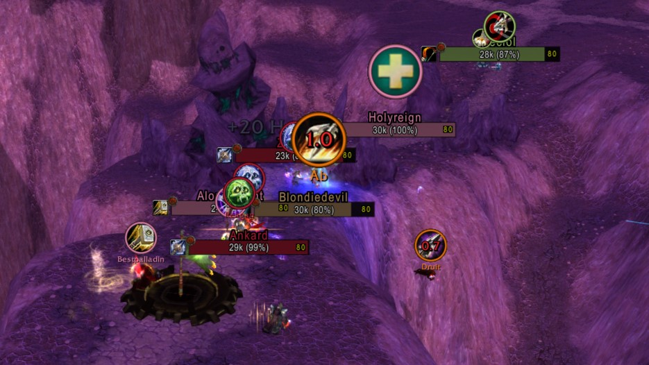<br><sub>Crowded team fight</sub></td>
<td align="center">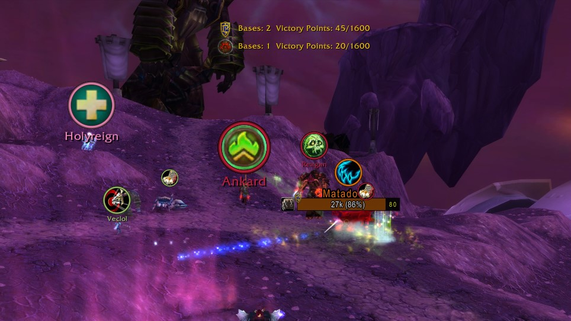<br><sub>Flag carrier</sub></td>
<td align="center">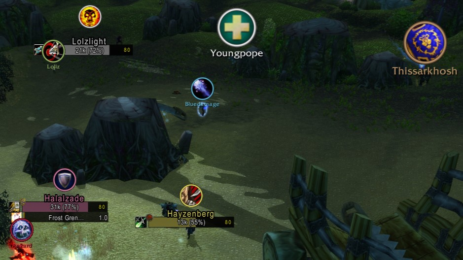<br><sub>Warsong Gulch</sub></td>
</tr>
</table>

### ⚙️ One window for all of it

Friendly and enemy plates side by side, healer alerts, tools, profiles — and the roadmap features already sitting in the rail, marked **soon**.

<p align="center">
  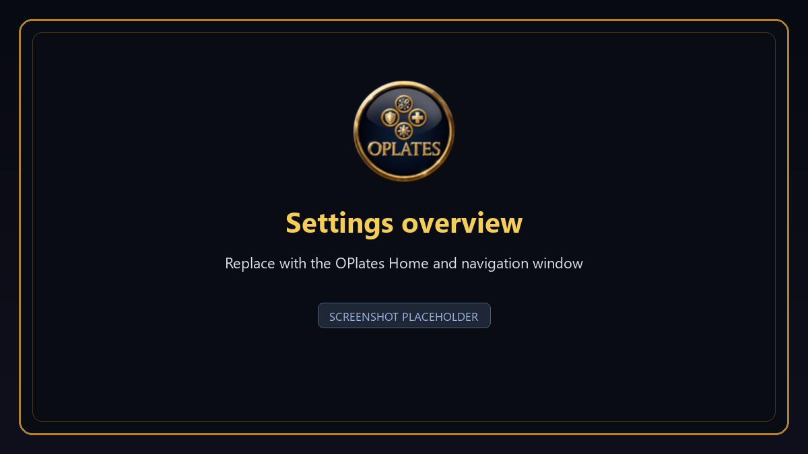
</p>
<p align="center"><sub><b>The settings window</b> — type <code>/op</code> and everything is here</sub></p>

---

## ⚡ Install in 30 seconds

1. Grab **`OPlates-v1.12.zip`** from [**Releases**](https://github.com/FreakySphere/OPlates/releases/latest).
2. Close World of Warcraft completely.
3. Extract the **`OPlates`** folder into your addons folder:

   ```text
   World of Warcraft\Interface\AddOns\OPlates\OPlates.toc
   ```

4. Start the game, tick **OPlates** on the AddOns screen, log in, type **`/op`**.

> ⚠️ One folder deep, not two. If you end up with `AddOns\OPlates\OPlates\`, the addon will not load. Upgrading and more help: [INSTALL.md](INSTALL.md).

## 🎮 Quick start

1. Type **`/op`** — the settings window opens (or use the minimap button under **Tools**).
2. Pick **Friendly Plates** or **Enemy Plates**.
3. Choose an **Icon mode**, then tick what you want: class, spec, healer, tank, pets, flag carrier.
4. Fine-tune with **Class Filters** and **Spec Filters** — filtering an icon never hides the player or their other information.
5. Want auras? Paste spell IDs into that side's **Buffs** / **Debuffs** box.
6. Nudge **icon size** and **position** until it sits right on your plates.
7. Open **Healer CC** and hit **Test** — drag the alert where you want it, outside combat.

## ⌨️ Commands

| Command | What it does |
|---|---|
| `/op` · `/oplates` | Open the themed settings window |
| `/op classic` | Open the classic settings window |
| `/op debug on` | Start detailed logging for this session |
| `/op debug off` | Stop logging |
| `/op debug reset` | Start a fresh debug session |
| `/op talent reset` | Forget learned specializations and reload the UI |

---

## 🧩 Compatibility

| | |
|---|---|
| **Game** | World of Warcraft: Wrath of the Lich King **3.3.5a** — `Interface 30300` |
| **Stock client** | ✅ Fully supported. Identity may take a moment on some plates. |
| **Patched client** | ✅✅ Instant identity, no hover needed — with a supported patch below |
| **Dependencies** | None. Libraries are bundled. |

### Supported `awesome_wotlk` patches

OPlates is built for two specific patches — **not** every fork that carries the name:

- 🟢 **[FreakySphere's awesome_wotlk](https://github.com/FreakySphere/awesome_wotlk/releases/latest)** — the superset build this addon was developed against. *Recommended.*
- 🟢 **[KhalGH's awesome_wotlk 0.1.4-f3](https://github.com/KhalGH/awesome_wotlk/releases/download/0.1.4-f3/AwesomeWotlk.7z)** — the fork OPlates originally grew up on.

The patch is entirely optional. OPlates detects what the client can do and switches its nameplate-unit integration on by itself the first time it finds a supported one; you can turn it off again under **Advanced**. A patch modifies your game client — use only the linked releases and read their instructions.

> Not Retail. Not Classic Era. Not Wrath Classic. **3.3.5a only.**

---

## 🗺️ Roadmap

Three things are planned. **No dates, no promises** — they ship when they are good enough.

**🧱 Plate Filters**
Hide individual nameplate elements — names, health bars, power bars, cast bars, icons — from whichever nameplate addon you run. TidyPlates, ThreatPlates, Kui Nameplates, NotPlater, ElvUI: OPlates will be able to strip the pieces you do not want, whatever is drawing them.

**🎨 Aura Filters**
A dedicated window with the full set of class, spec and racial buffs and debuffs as circular icons. Tick what you care about, drag to set which aura outranks which — instead of typing spell IDs by hand.

**⚔️ Raid & Dungeon**
A PvE layer in the spirit of BigWigs and DBM: when a boss puts something on a raid member, that player's circle becomes that debuff, that mechanic, that thing you must react to — visible on the nameplate itself, where your eyes already are.

---

## 🩺 If something looks off

**OPlates is not in the AddOns list** — check `Interface\AddOns\OPlates\OPlates.toc` exists, and that you are not one folder too deep.

**A class or spec stays unknown** — normal on a stock client. Target or mouse over the player once, or install a supported patch for instant identity.

**The healer alert button will not click in combat** — that is Blizzard, not OPlates. Set an in-combat modifier, make sure **Display only** is off, and configure the alert before the pull.

**Anything else** — type `/op debug on`, reproduce it, then open a [bug report](https://github.com/FreakySphere/OPlates/issues/new?template=bug_report.yml) with your OPlates version and whether your client is stock or patched. Never paste passwords, server credentials or tokens.

---

## 📄 Project & license

- **Download** — [latest release](https://github.com/FreakySphere/OPlates/releases/latest)
- **Source & issues** — [FreakySphere/OPlates](https://github.com/FreakySphere/OPlates)
- **License** — [GNU GPL-3.0-or-later](LICENSE)
- **Credits & asset terms** — [Copyright](COPYRIGHT.md) · [Branding](BRANDING.md) · [Third-party notices](THIRD_PARTY_NOTICES.md)

OPlates is an independent community project. It is not affiliated with or endorsed by Blizzard Entertainment or Warmane.

---

## 💛 Support OPlates

I built OPlates to give back to the lovely WotLK 3.3.5a community, and especially to support Warmane players and keep the spirit of this server alive. It took many long hours of work to make every plate and mechanism fixed and stable.

OPlates is completely free, and it always will be. But if it has made your games a little easier or a little more fun, a small donation is deeply appreciated to help keep this project growing and fuel my passion to create even more insane addons like this.

Whether you donate or just share OPlates with a friend, your support means the world to me. Thank you for being part of this community.

With love, **FreakySphere**

<div align="center">

[](https://reymit.ir/FreakySphere)

**USDT · TRC20** — scan the code or copy the address below


</div>

**Three addresses, three networks.** Hover a block and click the copy icon. Each one accepts a single network — anything else sent to it is lost permanently.

**USDT** · TRC20 — TRON network
```text
TFoVYvxDwCvyxWmsQXxEVwLgZhPkJFwzyk
```

**BNB** · BEP-20 — BNB Smart Chain
```text
0xfAcc945FB11975B17eAF82131558913574856133
```

**BTC** · native — Bitcoin
```text
bc1qqvl3edwwna38gh2xg9jhu9tz675g000x47mnwz
```

---

<div align="center">

Made with care for the **WotLK 3.3.5a** community by **FreakySphere**.

</div>
