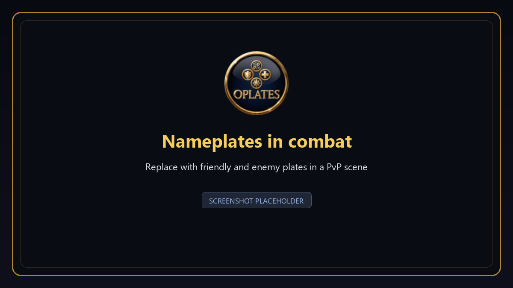
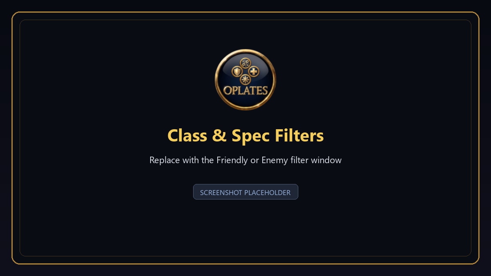
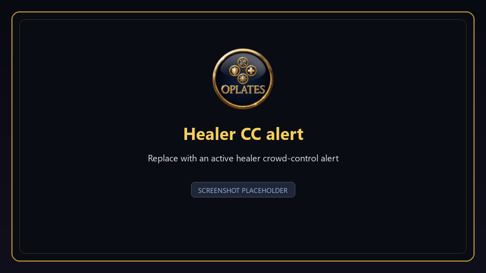

<div align="center">


# OPlates

### One circle. Every answer.

**The nameplate overlay that tells you who you are fighting — before you finish the thought.**

Built for **World of Warcraft: Wrath of the Lich King 3.3.5a**, with love for the Warmane community.

[](https://github.com/FreakySphere/OPlates/releases/latest)
[](#-compatibility)
[](LICENSE)
[](https://github.com/FreakySphere/OPlates/issues)

[✨ The idea](#-the-idea) · [🎯 What it does](#-what-it-does) · [📸 See it](#-see-it) · [⚡ Install](#-install-in-30-seconds) · [🧩 Compatibility](#-compatibility) · [🗺️ Roadmap](#-roadmap) · [💛 Support](#-support-oplates)

</div>

---

## ✨ The idea

Nameplate addons are very good at showing you **bars**. Health, resources, cast bars — all of it, beautifully.

None of them tell you **who** is behind the bar.

OPlates adds exactly one thing: a single **circular icon above every friendly and enemy player**, carrying the one piece of information you actually need in that half-second — their class, their spec, their role, the crowd control that just landed on them, or the buff you have been waiting for. The border is their class color. Target them and it pulses yellow. That is the whole addon, and that is why it works.

> **It does not replace your nameplates.** TidyPlates, ThreatPlates, Kui Nameplates, NotPlater, ElvUI — keep every bar, every font, every pixel of your setup. OPlates draws on top of it.

---

## 🎯 What it does

### 🟡 The circle

One circular icon per player and per supported pet — no clutter, no second health bar, no wall of text.

- **Class**, **specialization**, or **role** — healer and tank icons included, each with its own size
- A **class-colored border**, so you read the class before you read the icon
- **Pulsing yellow border** the moment you target someone, back to class color the instant you switch away
- A **question mark** until the client knows who that player is — never a wrong guess
- Optional **name underneath**, optional **Arena 1–5** numbers, optional **flag-carrier** icon

Choose per side. Your friendly plates and your enemy plates are configured completely independently.

### 🌀 Crowd control, the instant it lands

The class icon is **replaced by the CC icon immediately**, with the remaining duration ticking down — then swapped back the moment it ends. No delay, no stale icon, no guessing whether that stun is still on.

- **Smart diminishing returns** keep the timer honest across repeated CC
- **Priority order** decides what you see when effects overlap — a stun outranks a fear, a fear outranks a silence
- Works from a live aura when the client exposes one, and from a DR-aware estimate when it does not

### ✨ Your buffs and debuffs, not someone else's idea of important

Paste **spell IDs** into the friendly or enemy whitelist and that aura takes the circle's place while it is up. Independent lists per side. Crowd control always wins over an aura — you will never miss a stun because a HoT was prettier.

### 🚨 Healer CC alerts — the one that saves the pull

A second, separate layer: when a **healer in your group** gets crowd controlled, OPlates shows a movable on-screen alert — where you want it, at the size you want, with the countdown style you prefer, optionally with a sound, up to five at once.

An optional adjacent button can fire a **dispel or breaker your character actually knows**. Blizzard's secure-action rules apply: set the modifier before combat, then click with **Alt**, **Shift** or **Ctrl**. Prefer to keep it visual? **Display only** turns the click off and leaves the alert.

> A healer standing next to you is covered instantly. A healer across the map needs to be running OPlates too.

### 🧠 Built for the real 3.3.5a client

OPlates runs on a **stock, unpatched 3.3.5a client** — no patch required, no dependencies to install, libraries bundled.

On a stock client the game does not expose every visible nameplate as a unit, so identity can take a moment. OPlates learns it from mouseover, target, talent inspection, group data and combat events, and remembers it for as long as you allow.

With a supported **`awesome_wotlk`** patch it is a different experience entirely: visible players are known **instantly**, with no hover at all.

### 🛠️ Yours to shape

Separate friendly/enemy pages · class and spec filters · icon size and position per icon type · PvP-only modes · profiles you can save, switch, import and export · a themed settings window (or `/op classic`) · optional minimap button · session-only debug logs.

---

## 📸 See it

> **Placeholder images.** These are stand-ins — real in-game captures are coming. The filenames are fixed, so the screenshots can be dropped in without touching this README. See [`docs/screenshots/README.md`](docs/screenshots/README.md).

<table>
<tr>
<td width="50%"><br><sub><b>One icon per player</b> — class, spec and role at a glance</sub></td>
<td width="50%"><br><sub><b>The settings window</b> — everything in one place</sub></td>
</tr>
<tr>
<td width="50%"><br><sub><b>Class &amp; Spec Filters</b> — decide exactly who shows what</sub></td>
<td width="50%"><br><sub><b>Healer CC alert</b> — with one-click dispel</sub></td>
</tr>
</table>

---

## ⚡ Install in 30 seconds

1. Grab **`OPlates-v1.00.zip`** from [**Releases**](https://github.com/FreakySphere/OPlates/releases/latest).
2. Close World of Warcraft completely.
3. Extract the **`OPlates`** folder into your addons folder:

   ```text
   World of Warcraft\Interface\AddOns\OPlates\OPlates.toc
   ```

4. Start the game, tick **OPlates** on the AddOns screen, log in, type **`/op`**.

> ⚠️ One folder deep, not two. If you end up with `AddOns\OPlates\OPlates\`, the addon will not load. Upgrading and more help: [INSTALL.md](INSTALL.md).

## 🎮 Quick start

1. Type **`/op`** — the settings window opens (or use the minimap button under **Tools**).
2. Pick **Friendly Plates** or **Enemy Plates**.
3. Choose an **Icon mode**, then tick what you want: class, spec, healer, tank, pets, flag carrier.
4. Fine-tune with **Class Filters** and **Spec Filters** — filtering an icon never hides the player or their other information.
5. Want auras? Paste spell IDs into that side's **Buffs** / **Debuffs** box.
6. Nudge **icon size** and **position** until it sits right on your plates.
7. Open **Healer CC** and hit **Test** — drag the alert where you want it, outside combat.

## ⌨️ Commands

| Command | What it does |
|---|---|
| `/op` · `/oplates` | Open the themed settings window |
| `/op classic` | Open the classic settings window |
| `/op debug on` | Start detailed logging for this session |
| `/op debug off` | Stop logging |
| `/op debug reset` | Start a fresh debug session |
| `/op talent reset` | Forget learned specializations and reload the UI |

---

## 🧩 Compatibility

| | |
|---|---|
| **Game** | World of Warcraft: Wrath of the Lich King **3.3.5a** — `Interface 30300` |
| **Stock client** | ✅ Fully supported. Identity may take a moment on some plates. |
| **Patched client** | ✅✅ Instant identity, no hover needed — with a supported patch below |
| **Dependencies** | None. Libraries are bundled. |

### Supported `awesome_wotlk` patches

OPlates is built for two specific patches — **not** every fork that carries the name:

- 🟢 **[FreakySphere's awesome_wotlk](https://github.com/FreakySphere/awesome_wotlk/releases/latest)** — the superset build this addon was developed against. *Recommended.*
- 🟢 **[KhalGH's awesome_wotlk 0.1.4-f3](https://github.com/KhalGH/awesome_wotlk/releases/download/0.1.4-f3/AwesomeWotlk.7z)** — the fork OPlates originally grew up on.

The patch is entirely optional. OPlates detects what the client can do and switches its nameplate-unit integration on by itself the first time it finds a supported one; you can turn it off again under **Advanced**. A patch modifies your game client — use only the linked releases and read their instructions.

> Not Retail. Not Classic Era. Not Wrath Classic. **3.3.5a only.**

---

## 🗺️ Roadmap

Three things are planned. **No dates, no promises** — they ship when they are good enough.

**🧱 Plate Filters**
Hide individual nameplate elements — names, health bars, power bars, cast bars, icons — from whichever nameplate addon you run. TidyPlates, ThreatPlates, Kui Nameplates, NotPlater, ElvUI: OPlates will be able to strip the pieces you do not want, whatever is drawing them.

**🎨 Aura Filters**
A dedicated window with the full set of class, spec and racial buffs and debuffs as circular icons. Tick what you care about, drag to set which aura outranks which — instead of typing spell IDs by hand.

**⚔️ Raid & Dungeon**
A PvE layer in the spirit of BigWigs and DBM: when a boss puts something on a raid member, that player's circle becomes that debuff, that mechanic, that thing you must react to — visible on the nameplate itself, where your eyes already are.

---

## 🩺 If something looks off

**OPlates is not in the AddOns list** — check `Interface\AddOns\OPlates\OPlates.toc` exists, and that you are not one folder too deep.

**A class or spec stays unknown** — normal on a stock client. Target or mouse over the player once, or install a supported patch for instant identity.

**The healer alert button will not click in combat** — that is Blizzard, not OPlates. Set an in-combat modifier, make sure **Display only** is off, and configure the alert before the pull.

**Anything else** — type `/op debug on`, reproduce it, then open a [bug report](https://github.com/FreakySphere/OPlates/issues/new?template=bug_report.yml) with your OPlates version and whether your client is stock or patched. Never paste passwords, server credentials or tokens.

---

## 💛 Support OPlates

I built OPlates to give back to the lovely WotLK 3.3.5a community, and especially to support Warmane players and keep the spirit of this server alive. It took many long hours of work to make every plate and mechanism fixed and stable.

OPlates is completely free, and it always will be. But if it has made your games a little easier or a little more fun, a small donation is deeply appreciated to help keep this project growing and fuel my passion to create even more insane addons like this.

Whether you donate or just share OPlates with a friend, your support means the world to me. Thank you for being part of this community.

With love, **FreakySphere**

<div align="center">

[](https://reymit.ir/FreakySphere)

**USDT (TRC20)**  
Only send USDT on the **TRON (TRC20) network**. Using a different asset or network may result in lost funds.

<a href="https://tronscan.org/#/address/TFoVYvxDwCvyxWmsQXxEVwLgZhPkJFwzyk"></a>

[Wallet address: `TFoVYvxDwCvyxWmsQXxEVwLgZhPkJFwzyk`](https://tronscan.org/#/address/TFoVYvxDwCvyxWmsQXxEVwLgZhPkJFwzyk)

</div>

---

## 📄 Project & license

- **Download** — [latest release](https://github.com/FreakySphere/OPlates/releases/latest)
- **Source & issues** — [FreakySphere/OPlates](https://github.com/FreakySphere/OPlates)
- **License** — [GNU GPL-3.0-or-later](LICENSE)
- **Credits & asset terms** — [Copyright](COPYRIGHT.md) · [Branding](BRANDING.md) · [Third-party notices](THIRD_PARTY_NOTICES.md)

OPlates is an independent community project. It is not affiliated with or endorsed by Blizzard Entertainment or Warmane.

<div align="center">

Made with care for the **WotLK 3.3.5a** community by **FreakySphere**.

</div>
